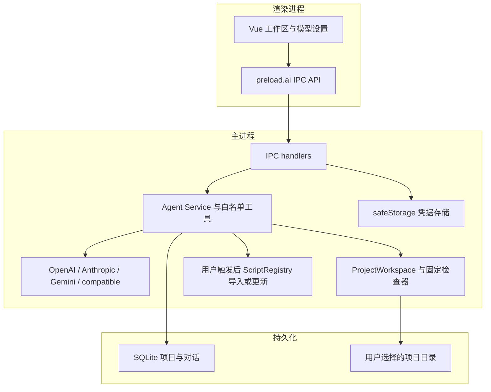

# AI 项目工作区与手动脚本导入

> 本文描述当前单仓实现；用户功能概览见 [v2.1.0 版本说明](../v2.1.0.md)。

**skills 触发词**：AI 项目、Agent 生成脚本、模型配置、手动导入脚本、项目构建导入、AiProjectWorkspace、createAgentService

| 仓库/服务 | 角色 |
|-----------|------|
| autoforge | Electron 桌面端，管理模型凭据、本机项目文件、Agent 会话、脚本校验和导入 |

**前置依赖**：[架构说明](../architecture.md) 中的主进程、preload、渲染进程与脚本注册表分层。

本文记录 Autoforge 单仓内模型配置、AI 项目会话、受限文件操作、手动构建与静态检查、脚本注册的完整实现入口。

## 1. 整体架构

模型配置元数据与凭据分开保存。项目目录由用户选择，文件读写与脚本检查始终由主进程执行。

## 2. 数据字段对照

来源为 src/shared/ai-types.ts 与 src/shared/ai-workspace-types.ts。

| 字段 | 类型 | 说明 |
|------|------|------|
| LlmProfile.provider | openai / anthropic / gemini / openai-compatible | 模型协议适配类型 |
| LlmProfile.baseUrl | string | Provider 服务端点 |
| LlmProfile.model | string | 用户配置的模型 ID |
| LlmProfileView.hasApiKey | boolean | 渲染进程可见的 API 密钥状态，不包含密钥值 |
| LlmProfileView.hasCredentials | boolean | 是否配置了 API 密钥或额外请求头凭据 |
| AiProject.rootPath | string | 规范化后的用户项目目录 |
| AiProject.language | javascript / python | 生成包的脚本语言 |
| AiProject.profileId | string | 项目关联的模型配置 |
| AiProject.importedScriptId | string? | 已导入脚本 ID，用于后续原位更新 |
| AiProject.pinned | boolean | 项目是否置顶，SQLite migration 008 持久化 |
| AiProjectTurn.status | running / complete / cancelled / error | 对话轮次状态 |
| AiAgentEvent.type | discriminated union | assistant_delta、tool、file_changes、check_result、import_result、turn_finished |

项目表和轮次表由迁移 007-ai-workspace.ts 建立。迁移 008-ai-project-pinned.ts 增加置顶字段和排序索引。密钥与额外请求头值不进入 SQLite。

## 3. 入口流程

1. 用户在项目工作区选择一个本机文件夹（允许已有文件）、项目语言和已配置凭据的模型。
2. 渲染进程通过 preload 的 pickProjectFolder 与 createProject 请求主进程创建项目。
3. AgentService.createProject 验证模型配置，并调用 validateProjectRoot 检查目录、写权限和符号链接。已有普通文件会留在原位，Agent 只通过受限工具访问文件。
4. AiWorkspaceRepository 保存规范化目录、语言、模型 ID 和状态。目录内容仍留在用户选择的位置。
5. 发送提示词时，IPC handler 为发起请求的窗口转发 Agent 事件。

## 4. Agent 与手动导入流程

createAgentService 在每个项目上限制并发会话、轮次、工具调用和上下文大小。每次模型请求都会附带内置 Autoforge 开发规范，按所选 JavaScript / Python 语言提供清单和入口约定。Agent 工具只允许列出、读取和写入项目文件；普通聊天不会调用构建、校验或导入服务。

写入工具需要提供每个已有文件的 SHA-256 期望值。主进程再次计算文件哈希，发现冲突时不会覆盖用户的并行编辑。写入使用原子替换和受限回滚。

用户点击“导入脚本”后，importProject 按顺序执行以下步骤。该流程不调用模型，也不自动修复文件：

1. 项目存在 package.json `scripts.build` 时，project-builder 执行 `npm run build`；无构建脚本则跳过构建。
2. scriptWorkspace.validatePackageDirectory 校验清单和入口。
3. JavaScript 使用 Node 固定语法检查；Python 使用固定 AST 检查器。
4. ScriptRegistry.importFromPath 新增脚本，或 updateFromProject 更新已关联脚本。

构建失败或任一检查失败都会停止导入并返回诊断。检查器不会运行生成入口文件，导入成功后也不会触发 runner。用户从正常脚本详情流程启动脚本。

## 5. 模型凭据

模型 profile 元数据通过现有 AppConfig 保存。ModelCredentialStore 将每个 profile 的 API key 和额外请求头值分别加密写入 userData 的凭据文件。

Renderer 使用 listProfiles 获取 LlmProfileView，使用 setCredentials 或 clearCredentials 更新凭据。IPC 从不提供读取密钥或额外请求头值的 API。额外请求头名称会显示在配置表单中，已保存的请求头值保持只写。连接测试复用同一 Provider adapter，并将请求异常归一化为不含响应正文或密钥的状态信息。

Provider adapters 位于主进程，分别实现 OpenAI Chat Completions、Anthropic Messages、Gemini generateContent 和 OpenAI-compatible SSE 流。

## 6. 界面与导航

WorkspaceShell 提供导航轨、上下文侧栏、主工作区和检查器尺寸状态。useWorkspaceNavigation 持久化视图、项目/脚本上下文、折叠状态和宽度。

AiProjectWorkspace 显示项目列表、持久化对话、流式 Agent 输出、取消操作和提示词输入。助手回复通过 renderAiMarkdown 渲染；项目会话支持受限图片和文本类附件。检查器汇总文件变更、冲突、包与语法检查、手动导入结果。项目操作菜单可使用系统文件管理器或配置的编辑器打开项目目录。

模型 profile 在设置的“模型”分区编辑。API key 和额外请求头值都是只写输入，保存后不从 IPC 回显。项目条目单击仍打开对话，独立操作菜单支持在系统文件管理器或已配置编辑器中打开项目目录，以及重命名、置顶、导出对话和删除。删除需通过两次确认。轮次导出为 JSON，包含轮次状态、文件变更、检查和导入关联，不包括项目文件、项目根路径或模型凭据。页面路由切换时工作区组件通过 KeepAlive 保留会话状态。历史、Hub、指南与设置作为工作区主内容渲染，脚本列表和运行服务仍由 App.vue 根组件持有。

## 7. 代码路径速查

| 用途 | 路径 |
|------|------|
| 共享 provider 类型和项目事件 | src/shared/ai-types.ts、src/shared/ai-workspace-types.ts |
| IPC channel | src/shared/ipc-channels.ts |
| Provider adapter 和 presets | src/main/services/ai/*-provider.ts、provider-presets.ts |
| 安全凭据存储与 profile 服务 | src/main/services/ai/model-credential-store.ts、model-profile-service.ts |
| 项目 SQLite migration/repository | src/main/db/migrations/007-ai-workspace.ts、src/main/db/repositories/ai-workspace-repository.ts |
| 项目文件读写和冲突保护 | src/main/services/ai/project-workspace.ts |
| 包与语法校验 | src/main/services/ai/project-checks.ts |
| Agent 编排、默认开发规范和工具白名单 | src/main/services/ai/agent-service.ts、autoforge-development-prompt.ts、agent-tools.ts |
| preload API 类型 | src/preload/index.ts、src/renderer/src/env.d.ts、src/main/ipc/ai-workspace-handlers.ts |
| AI 项目视图与状态 | src/renderer/src/components/AiProjectWorkspace.vue、src/renderer/src/composables/useAiProjectWorkspace.ts |
| 项目持久化与轮次导出 | src/main/db/migrations/008-ai-project-pinned.ts、src/main/db/repositories/ai-workspace-repository.ts、src/main/services/ai/project-conversation-export.ts |
| 模型设置视图 | src/renderer/src/components/ModelProfilesView.vue、src/renderer/src/composables/useModelProfiles.ts |
| UI 路由工作台 | src/renderer/src/App.vue、WorkspaceShell.vue、useWorkspaceNavigation.ts |

## 8. 调试建议

1. 配置问题先检查模型设置里的 provider、endpoint、model、密钥状态和连接测试结果。不要将真实密钥写入日志或测试输出。
2. 项目目录校验失败时，在 validateProjectRoot 和 createProjectWorkspace 处检查规范化路径、写入权限和符号链接判定。
3. Agent 工具拒绝请求时，在 createAgentTools.execute 检查工具名、JSON 参数和期望哈希。该白名单不应通过新增任意 shell 工具扩展。
4. 检查失败时读取 check_result event 的稳定 code 与 diagnostics。入口检查应确认调用 node --check 或 Python AST，不应执行脚本。
5. 手动导入失败时在 importProject、project-builder 与 ScriptRegistry.updateFromProject 检查构建结果、检查状态、关联脚本 ID 和注册表事务。
6. 重开项目问题检查 AI_PROJECT_GET、AI_PROJECT_TURNS_LIST 与项目导航状态是否返回同一 project ID。

独立验证使用 npm run test:unit、npm run lint 和 npm run build。Agent、文件系统、检查器、profile/credentials 与 IPC 均有对应 node:test 文件。

## 9. 相关文档

| 文档 | 内容 |
|------|------|
| [v2.1.0 版本说明](../v2.1.0.md) | 当前 AI 项目工作区行为与手动构建导入 |
| [v2.0.0 版本说明](../v2.0.0.md) | 初次引入 AI Agent 与统一工作台 |
| [架构说明](../architecture.md) | Electron 分层、主进程模块与应用生命周期 |
| [脚本包规范](../script-spec.md) | Agent 生成包使用的 autoforge.json 契约 |
| [设计规格](../superpowers/specs/2026-11-22-v2-agent-workspace-design.md) | 已批准的 v2.0 功能范围 |
